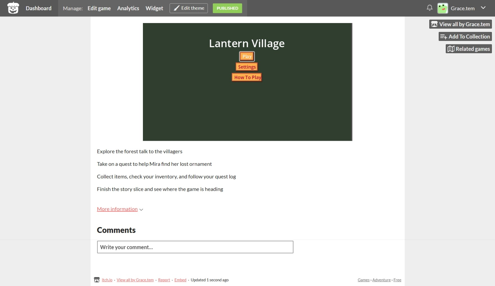

# Lantern Village
 A cozy top-down godot game. Explore, talk to the people you meet,complete their tasks and get rewards
## Screenshot

## Try It

[Demo Link](https://gracetem.itch.io/latern-village)

Just open the link and give it a try.

## Features

**Main Menu**- has the play, settings, howw to play and quit button. 

**An Inventory** - that displays item and their description ( Tab to show Inventory)

**Player Movement** - left, right, backward, forward. it is top down

**NPC** - Interact with them and can accept their quests and do them 

**Dialogues** - That displays tasks

**Quest Panel** - Shows what quest is needed to complete (Q to show Quest Panel)

**End Panel** - After completing all the quest available (which is one presently)

## Credit

Jewellery Art - @zer0kay on Itch.io

latern Art - @karsiori on Itch.io

Npc Art - @chierit on Itch.io

Player Art - @MikAnimus on Itch.io

GUI Art - @Elysian Game Studio on Itch.io, @kixelcraft
Scene Art - @Snakerser

## Made By

[Grace](https://github.com/Temi-ay)

